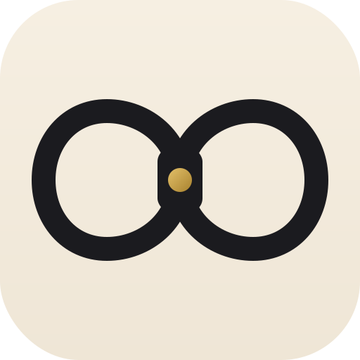
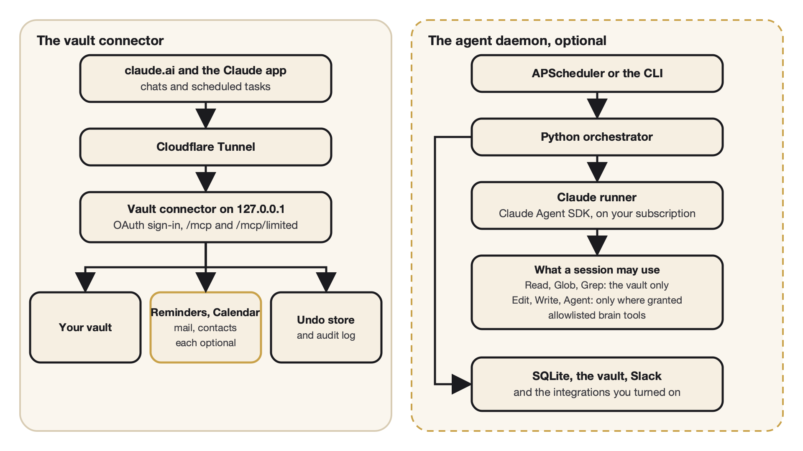

<p align="center">
  
</p>

<h1 align="center">tandem</h1>

<p align="center">
  <strong>A personal assistant for your own Obsidian vault, on a Mac you own, used from the Claude app.</strong>
</p>

<p align="center">
  <a href="LICENSE"></a>
  
  
  
  
</p>

<p align="center">
  <a href="#getting-started">Getting started</a> ·
  <a href="docs/vault-connector-setup.md">Setup guide</a> ·
  <a href="docs/ARCHITECTURE.md">Architecture</a> ·
  <a href="SECURITY.md">Security</a> ·
  <a href="CONTRIBUTING.md">Contributing</a>
</p>

---

The front door is the **vault connector**: a small server on your Mac that lets
your Claude chats, on the phone or the web, search, read and add to the vault.
It works under fixed rules, and anything larger waits for your Approve tap. On
top of it you can run an **agent daemon** that works through scheduled runs,
connect **Slack**, and turn on **Apple Reminders, Calendar, mail and contacts**.

Everything personal (your name, family, vault layout, lists, domain) stays in a
private `user/` folder that is never committed. The tracked tree holds the
code, the rules, the templates and the examples.

## What you get

| Part | What it does |
|---|---|
| **Vault connector** | Your vault on claude.ai over MCP, through a Cloudflare Tunnel, with its own sign-in (a password and a six-digit code). Two endpoints: "Vault" for your own chats and "Vault, limited" for scheduled tasks. No tool deletes or moves a note, sends anything or runs a command. Small edits run at once, larger ones wait for your Approve tap, every call is logged, and every edit can be undone. |
| **Starter vault** | `init-vault` creates a vault from the shipped templates: the rule file, the writing and capture rules, a daily note template and the open-item format the connector writes. |
| **Agent daemon** (optional) | Agents written in Markdown, scheduled in YAML, each run as a Claude Code session through the Claude Agent SDK on your subscription. They all speak as one assistant, Alfred. Anything that reaches the world goes through an action queue with approvals. |
| **Slack** (optional) | A shared channel and a private one. Every morning one message per thing, with buttons; every night a follow-up run that works through what was left open. |
| **Apple integrations** (optional) | Reminders, Calendar, contacts and iCloud mail (read and archive only), each switched on by itself. |

## Requirements

- A Mac that stays on, with Homebrew
- Python 3.12 (`brew install python@3.12`)
- A Claude subscription
- A domain of your own on Cloudflare, for the tunnel that carries claude.ai's
  traffic to your Mac
- An authenticator app for the sign-in code
- An Obsidian vault, or an empty folder for a new one

## How it fits together

<p align="center">
  
</p>

The connector and the daemon are separate processes; the connector works
without the daemon.

## Getting started

Setting up the connector is a one-time job. The
[setup guide](docs/vault-connector-setup.md) has every command and what to
check after each step. In outline:

1. Install Python 3.12 with Homebrew, clone the repository and run `make install`.
2. Copy the two example files from `examples/` into a private `user/` folder
   and fill in your name, your vault's path and your domain.
3. Set the sign-in password and add the six-digit code to your authenticator app.
4. Create a Cloudflare Tunnel to the connector and load the launchd jobs.
5. Add the connector to claude.ai twice, as "Vault" and "Vault, limited", and
   set the tool permissions the guide lists.

Then ask Claude, in a chat with "Vault" on, to search your vault for a note you
know.

## The optional parts

<details>
<summary><strong>The agent daemon</strong></summary>

The starter kit ships a housekeeping pass, discovery, inbox and people agents,
a housing agent (two German portals, so useful in Germany only), the
night-time follow-up run and the two chat agents. Live runs use the Claude
login that Claude Code keeps in the macOS keychain: install Claude Code, sign
in once by running `claude`, and never set `ANTHROPIC_API_KEY`. Copy
`examples/phd_student/sources.yaml` to `user/sources.yaml` and `.env.example`
to `.env`, then:

```bash
.venv/bin/brain doctor
.venv/bin/python -m src.cli --run scout --dry-run   # inspect a mode
.venv/bin/python -m src.cli --run scout             # run it through Claude
.venv/bin/python -m src.orchestrator.scheduler      # start the scheduler
```

`make demo` dry-runs the example overlay without Claude. See
[Agent authoring](docs/AGENT_AUTHORING.md) for the agent file format,
[Providers and runtime](docs/PROVIDERS.md) for the sign-in, and
[Integrations](docs/INTEGRATIONS.md) for the daemon's launchd job and backups.

</details>

<details>
<summary><strong>Slack</strong></summary>

Create the app from `config/slack_app_manifest.yaml` and follow the Slack
section of [Integrations](docs/INTEGRATIONS.md). Every message in the private
channel goes to Alfred; in the shared channel only messages that name or
mention Alfred. `BRAIN_SLACK_OFF=1` in `.env` turns Slack off.

</details>

<details>
<summary><strong>Apple integrations</strong></summary>

Switch them on one by one under `integrations:` in `user/vault_connector.yaml`.
Calendar, mail and contacts sign in to iCloud with your Apple ID and an
app-specific password kept in the login Keychain; Reminders use EventKit and
need a one-time permission. Section 4 of the setup guide and
[Integrations](docs/INTEGRATIONS.md) have the details.

</details>

## Repository map

| Path | What it holds |
|---|---|
| `src/brain/connector/` | The vault connector |
| `src/orchestrator/` | Scheduler, agent runner, Slack reply routing |
| `src/brain/` | Brain tools, actions, follow-ups, plugins |
| `config/` | Shipped agents, modes, policies and the Slack manifest |
| `templates/vault/` | The starter vault that `init-vault` copies |
| `examples/` | Example private files to copy into `user/` |
| `deploy/launchd/`, `ops/` | launchd templates for the connector and the daemon |
| `docs/` | The guides listed below |
| `user/` | Your private settings and agents, gitignored |

## Development

```bash
make test       # pytest
make typecheck  # mypy
make audit      # dependency audit
make scan       # personal values in the tracked tree
```

See [CONTRIBUTING.md](CONTRIBUTING.md).

## Safety

- The connector listens on 127.0.0.1 only, signs in one user with a password
  and a six-digit code, binds each token to its endpoint, and writes nothing
  outside the vault, to rule files or to dot folders.
- The daemon's sessions have no shell and no generic web tools, load nothing
  from your own Claude setup, and get only the tools their agent file grants.
- Sensitive effects wait for a person's approval. Mail, calendar, contact, web
  and intake content is treated as data, never as instructions.
- `.env`, `user/`, databases and tokens are never committed.

[SECURITY.md](SECURITY.md) has the trust boundaries and how to report a problem.

## Documentation

| Guide | What it covers |
|---|---|
| [Vault connector setup](docs/vault-connector-setup.md) | The one-time setup, step by step |
| [Vault connector design](docs/vault-connector-design.md) | Why the connector is built the way it is |
| [Architecture](docs/ARCHITECTURE.md) | The daemon, the places, the action queue |
| [Agent authoring](docs/AGENT_AUTHORING.md) | Writing an agent file |
| [Integrations](docs/INTEGRATIONS.md) | Slack, Apple, Garmin, launchd, backups |
| [Database](docs/DATABASE.md) | The SQLite tables |
| [Providers and runtime](docs/PROVIDERS.md) | How agents sign in and run |
| [Backup and restore drill](docs/RESTORE_DRILL.md) | Backups and proving a restore |
| [Release process](docs/RELEASE.md) | The maintainer's way to a public tree |

## License

MIT. See [LICENSE](LICENSE).
